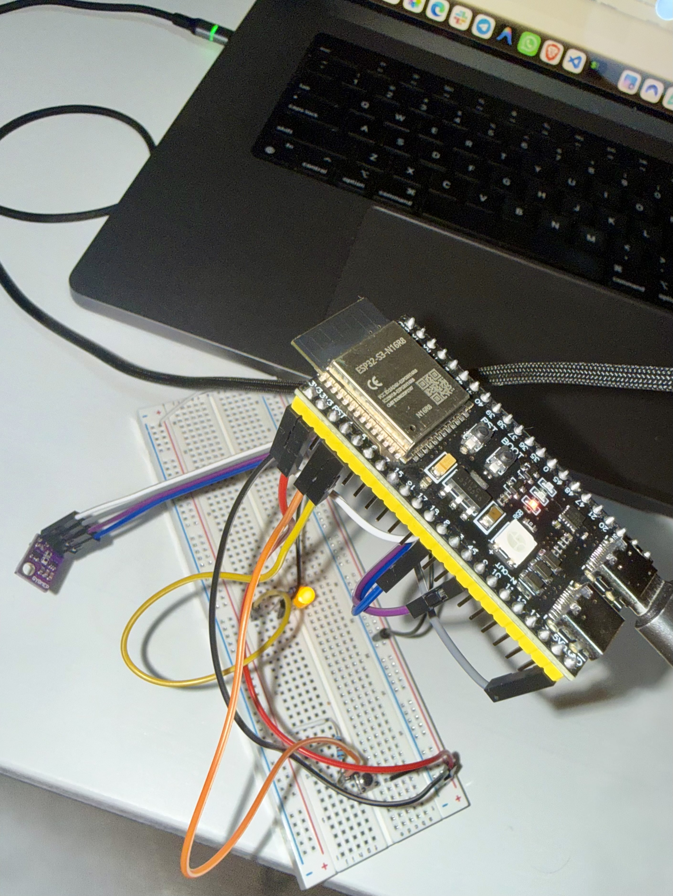

# Taller 1 — SEyTR 2026-27

Memoria de las prácticas del Taller 1 sobre la placa **ESP32-S3-DevKitC-1**
(ESP-IDF). El proyecto integra cuatro módulos en un mismo firmware: salida
digital con parpadeo, lectura de pulsador con antirrebote, sensor ambiental
BME280 por I2C y una consola serie por UART0.

## Integrantes y reparto de roles

| Integrante | Rol |
|---|---|
| Heysser Aguilera | Trabajo conjunto en las cuatro prácticas |
| Álvaro Labrada Isidro | Trabajo conjunto en las cuatro prácticas |

El trabajo se hizo de forma conjunta, sin reparto estricto por práctica: ambos
participamos en el montaje, el código y la documentación. Durante la
demostración se puede preguntar por cualquier parte del código a cualquiera de
los dos integrantes.

## Tabla de asignación de pines

| Elemento | GPIO | Dirección | Uso |
|---|---:|---|---|
| LED externo | GPIO5 | Salida | LED entre el pin y masa, con resistencia en serie. Nivel que enciende: **1**. |
| Pulsador | GPIO4 | Entrada | Pulsador a masa con **pull-up externa**; pull-up interna desactivada. Nivel pulsado: **0**. |
| I2C — SDA | GPIO8 | Bidireccional | Línea de datos del bus I2C. |
| I2C — SCL | GPIO9 | Salida (maestro) | Línea de reloj del bus I2C. |
| Consola | UART0 (USB-UART) | — | Se conservan los pines por omisión de UART0 (no se reasignan). |

La fuente única de los pines es [`main/pines.h`](main/pines.h); el resto del
código no escribe números de GPIO.

## Montaje

- **LED (GPIO5):** ánodo/cátodo según montaje, LED en serie con su resistencia
  entre el pin y masa (`GND`). El nivel lógico `1` enciende.
- **Pulsador (GPIO4):** entre el pin y masa, con una **resistencia de pull-up
  externa** a `3V3`. En reposo el pin lee `1`; al pulsar, `0`. La pull-up
  interna se desactiva por software para que el reposo lo fije la externa.
- **BME280 (I2C):** conectar con la placa **apagada**.

  | BME280 | ESP32-S3 |
  |---|---|
  | VIN | 3V3 _(no conectar a 5V)_ |
  | GND | GND |
  | SDA | GPIO8 |
  | SCL | GPIO9 |

  Dirección I2C comprobada en la placa: **`0x76`**.
- **Consola:** la placa se conecta al PC por el conector **USB-to-UART**
  (el puente USB-serie de la placa), no por el USB nativo del ESP32-S3. Por el
  USB nativo se ven las trazas, pero **lo que se teclea no llega a UART0**.



*Montaje sobre protoboard: placa ESP32-S3, LED con su resistencia, pulsador y
sensor BME280 (módulo morado). Vista adicional en [`results/IMG_6407.jpeg`](results/IMG_6407.jpeg).*

## Compilación y grabación

El proyecto se compila y graba con la **extensión ESP-IDF de Espressif para
VS Code** (versión de ESP-IDF utilizada: **v6.1**). El `target` (`esp32s3`) y
`CONFIG_FREERTOS_HZ=1000` quedan fijados en
[`sdkconfig.defaults`](sdkconfig.defaults).

**Pasos en VS Code** (barra de estado inferior de la extensión ESP-IDF):

1. **Seleccionar el puerto** (*ESP-IDF: Select Port*): elegir el puerto serie de
   la placa.
2. **Fijar el chip** (solo la primera vez, *ESP-IDF: Set Espressif Device
   Target*): `esp32s3`.
3. **Compilar** (*ESP-IDF: Build your Project*).
4. **Grabar** (*ESP-IDF: Flash your Project*), tipo de grabación **UART**.
5. **Monitor serie** (*ESP-IDF: Monitor your Device*) para ver las trazas y usar
   la consola.

El botón *Build, Flash and Monitor* hace los pasos 3-5 de una vez. Todas estas
acciones están también en la paleta de comandos (`Cmd/Ctrl+Shift+P`, escribir
«ESP-IDF»).

> **Importante para la consola:** conectar el cable USB al **puerto
> USB-to-UART** de la placa. Por el USB nativo del ESP32-S3 se ven las trazas,
> pero lo que se teclea **no llega a UART0**.


## Estructura del proyecto

```
.
├── CMakeLists.txt
├── sdkconfig.defaults          # versionado (build/ y sdkconfig, ignorados)
├── components/                 # drivers reutilizables
│   ├── led/                    # LED en pin de salida
│   ├── pulsador/               # pulsador en pin de entrada (sin ISR propia)
│   └── bme280/                 # API oficial Bosch (BSD-3-Clause)
└── main/
    ├── main.c                  # solo inicializa y arranca los módulos
    ├── pines.h                 # asignación única de pines
    ├── filtro.c / filtro.h     # antirrebote (guarda + confirmación)
    ├── ejercicio1.*            # salida digital y parpadeo
    ├── ejercicio2.*            # pulsador con interrupción + antirrebote
    ├── ejercicio3.*            # sensor BME280 por I2C
    └── ejercicio4.*            # consola serie por UART0
```

---

## Práctica P1A — Salida digital y parpadeo

**Qué se construyó.** Un LED en GPIO5 que parpadea con período estable mediante
una tarea de FreeRTOS que usa `xTaskDelayUntil()` para mantener la cadencia. El
período por defecto es **1000 ms** y puede cambiarse en caliente desde la
consola (`l <ms>`).

**Decisiones.**
- El driver del LED ([`components/led`](components/led)) no conoce el pin ni el
  montaje: los recibe en `led_iniciar()`. El nivel de encendido (`1`) lo fija
  el montaje, no el código.
- Período por defecto **1000 ms** (500 ms encendido / 500 ms apagado), constante
  `CONFIG_SEYTR_PERIODO_MS` en `ejercicio1.c`; la tarea relee el período en cada
  ciclo para que la consola pueda modificarlo.
- La tarea del LED expone funciones para que la consola tome el control
  (`ejercicio1_fijar_estado_led()`, `ejercicio1_pausar_parpadeo()`,
  `ejercicio1_cambiar_periodo()`, con un mínimo de 20 ms por estabilidad).

**Resultados.** Ver [`results/01_parpadeo.txt`](results/01_parpadeo.txt): traza de
catorce conmutaciones con el período medido (líneas `Diferencia=NNN ms`, unos 500 ms
por semiciclo, es decir 1 s de período).

---

## Práctica — Pulsador con antirrebote

**Qué se construyó.** Lectura del pulsador (GPIO4) por **interrupción**: la ISR
solo captura el instante en microsegundos y lo envía por una **cola** a una
tarea, que aplica un filtro antirrebote y lleva la cuenta de pulsaciones
válidas, trazándolas.

**Decisiones.**
- El driver del pulsador ([`components/pulsador`](components/pulsador)) deja el
  pin preparado para interrumpir pero **no** atiende la interrupción: la ISR, la
  cola y el antirrebote son del programa.
- Pull-up interna desactivada: el reposo lo fija la resistencia externa.
- Antirrebote con **ventana de guarda de 50 ms** y **confirmación de nivel a
  los 20 ms** ([`main/filtro.c`](main/filtro.c)). La confirmación vuelve a leer
  el pin pasado el rebote para rechazar flancos espurios.

**Resultados.** Ver [`results/02_pulsaciones.txt`](results/02_pulsaciones.txt): diez
pulsaciones con el contador llegando a diez, sin rebotes contados de más.

---

## Práctica — Sensor BME280 (I2C)

**Qué se construyó.** Identificación y lectura del sensor BME280 usando la
**API oficial de Bosch**. Se recorre el bus I2C, se confirma la identidad del
chip (`chip_id`), se leen los datos de calibración y se configuran las tres
magnitudes (temperatura, presión, humedad) con **sobremuestreo 1x**. Después se
toman lecturas compensadas en modo forzado cada 2 s.

**Decisiones.**
- Se usa la API oficial Bosch ([`components/bme280`](components/bme280),
  BSD-3-Clause) con funciones de interfaz I2C propias (`leer_registro`,
  `escribir_registro`, `esperar_microsegundos`).
- Dirección I2C `0x76`, filtro IIR desactivado, modo **forzado** (una medida
  bajo demanda), con el tiempo de conversión calculado por
  `bme280_cal_meas_delay()`.
- Período de muestreo: **2 s** (ver justificación más abajo).

**Resultados.** Ver [`results/03_sensor.txt`](results/03_sensor.txt): detección en el
bus (`0x76`), identificación (`ID 0x60`), una lectura en reposo y otra con la mano
sobre el sensor (la temperatura sube de ~25 °C a 27 °C).

---

## Práctica P2 — Consola serie por UART0

**Qué se construyó.** Una consola por UART0 (la del monitor) con una tarea de
recepción que acumula caracteres hasta el fin de línea, separa comando y
argumentos y despacha sobre una **tabla de comandos**.

**Decisiones.**
- Fin de línea: se acepta `\r` (lo que envía el monitor de ESP-IDF al pulsar
  Intro) y `\n`.
- **Límite de línea de 64 caracteres:** una línea más larga se descarta entera
  al llegar su fin, se avisa, y la consola sigue respondiendo.
- Despacho por tabla de punteros a función, no por cadena de comparaciones.
- Comando desconocido y línea vacía se tratan sin fallo.

**Comandos de la consola** (ver [sección de comandos](#comandos-de-la-consola)).

**Resultados.** Ver [`results/04_consola.txt`](results/04_consola.txt): sesión con los
tres comandos, el cambio de período y un comando desconocido tratado.

**Estado.** Los tres comandos responden; el comando de estado incluye las
medidas del sensor y el contador de pulsaciones, y el comando del LED permite
encender, apagar y **cambiar el período**. El comando desconocido y la línea
vacía se tratan sin fallo. El sensor se muestrea en su propia tarea
(`tarea_bme280`), de modo que la consola sigue respondiendo mientras el LED
parpadea y el sensor se actualiza.

---

## Comandos de la consola

Sintaxis actual (un comando por línea, Intro para ejecutar):

| Comando | Sintaxis | Descripción |
|---|---|---|
| `h` | `h` | Muestra la lista de comandos disponibles. |
| `e` | `e` | Estado del sistema: tiempo de actividad, **contador de pulsaciones**, **medidas del sensor** (temperatura, presión, humedad), puerto y tick. |
| `l` | `l <on\|off\|auto\|<ms>>` | Controla el LED: `on` enciende, `off`/`0` apaga (pausan el parpadeo), `auto` reanuda el parpadeo, y un número fija el período de parpadeo en ms (mínimo 20, p. ej. `l 500`). |

Ejemplos: `l on`, `l off`, `l auto`, `l 500`. Una línea vacía no hace nada;
un comando desconocido avisa con un mensaje.

---

## Justificaciones

**Ventana de antirrebote.** Fijamos la ventana de guarda en **50 ms**
([`main/ejercicio2.c`](main/ejercicio2.c)): el rebote de un pulsador mecánico
dura típicamente unos pocos milisegundos, de modo que 50 ms lo cubren con holgura
sin descartar pulsaciones reales (incluso rápidas). Añadimos una **confirmación de
nivel a los 20 ms**, que vuelve a leer el pin pasado el rebote para rechazar los
flancos espurios al soltar que, fuera de la ventana, se contarían como una
pulsación nueva. La justificación es cualitativa: no tomamos una medida propia del
rebote, lo que se recoge en la autoevaluación.

**Período de muestreo del sensor.** Muestreamos el BME280 cada **2 s**. En modo
forzado con sobremuestreo 1x la conversión de las tres magnitudes tarda unos
pocos milisegundos, así que el período no lo limita el sensor sino el uso del
dato: temperatura, presión y humedad ambientales cambian lentamente (segundos a
minutos), y la medida se consulta de forma puntual con el comando `estado`, por
lo que leer cada 2 s da datos frescos sin saturar el bus ni consumir energía de
forma innecesaria.

---

## Resultados (capturas y trazas)

Las evidencias se guardan en [`results/`](results/) y se citan desde el apartado
de cada práctica: [`01_parpadeo`](results/01_parpadeo.txt),
[`02_pulsaciones`](results/02_pulsaciones.txt), [`03_sensor`](results/03_sensor.txt)
y [`04_consola`](results/04_consola.txt), más las fotos del montaje
([`IMG_6408`](results/IMG_6408.jpeg), [`IMG_6407`](results/IMG_6407.jpeg)). El
índice está en [`results/README.md`](results/README.md).

## Autoevaluación (rúbrica 0 / 1 / 2)

Autoevaluación de la pareja según la rúbrica del guion (propuesta, a confirmar):

| Criterio | Nota | Justificación |
|---|:--:|---|
| C1 · Salida digital y temporización | 2 | El LED parpadea con período estable de 1 s y la traza por conmutación (`Diferencia=NNN ms`) permite medirlo en el monitor. |
| C2 · Interrupción y antirrebote | 1 | Rutina de atención mínima, antirrebote en la tarea y recuento exacto, también con pulsaciones largas. La ventana se justifica de forma cualitativa, sin una medida propia del rebote, por lo que no cumplimos del todo el nivel 2. |
| C3 · Sensor por I2C | 2 | Dispositivo confirmado en el bus e identificado (0x60); lecturas compensadas, plausibles y coherentes ante un cambio provocado. |
| C4 · Consola por UART | 2 | Tres comandos, despacho por tabla, entrada robusta (línea vacía y línea larga) y comando desconocido tratado. |
| C5 · Integración y documentación | 2 | Componentes separados y pines en un solo sitio; README completo y coincidente con el código, con evidencias en `results/`. |

**Lo que no llegó a funcionar / se dejó pendiente.** La ventana de antirrebote se
justificó de forma cualitativa, sin una medida propia del rebote; y las medidas
del sensor solo se consultan por la consola, no se trazan periódicamente en el
monitor.

## Fuentes externas y herramientas de asistencia

**Código base proporcionado por el profesorado / material de la asignatura.**
Partimos de código facilitado en clase, que adaptamos a nuestro montaje y
proyecto:
- Componentes [`components/led`](components/led) y
  [`components/pulsador`](components/pulsador): **basados en el código del
  profesor y adaptados por nosotros** a nuestro montaje y proyecto (el componente
  no conoce el pin ni el montaje; los recibe al iniciarse).
- Filtro antirrebote [`main/filtro.c`](main/filtro.c): código de las
  **diapositivas 19 y 20 de U2-S2**, puesto en función para reutilizarlo.
- Tarea de recepción de la consola ([`main/ejercicio4.c`](main/ejercicio4.c)):
  parte del método de lectura por consola visto en clase (`read(STDIN_FILENO)`,
  "tarea_teclado del profesor").

**Librerías externas importadas.**
- **BME280 Sensor API** (Bosch Sensortec), licencia **BSD-3-Clause**:
  <https://github.com/BoschSensortec/BME280_SensorAPI>. Importada sin modificar
  en [`components/bme280`](components/bme280); los archivos originales conservan
  su aviso de licencia (`components/bme280/LICENSE`). El código propio es solo
  la capa de interfaz I2C en [`main/ejercicio3.c`](main/ejercicio3.c).

**Documentación consultada.**
- Documentación de ESP-IDF (build system, drivers GPIO/I2C/UART, FreeRTOS).
- Guía de usuario de la placa ESP32-S3-DevKitC-1 (apartado «Description of
  Components», puerto USB-to-UART).

**Herramientas de asistencia de IA.**
- **Claude Code** (Anthropic): usado para la **redacción del README** y como apoyo
  en la **depuración e integración** (p. ej. detectar que el muestreo del sensor
  bloqueaba el arranque de la consola). Las decisiones de diseño, el montaje
  físico y la adaptación del código son de los integrantes, que mantienen la
  autoría y la comprensión técnica de lo entregado.
